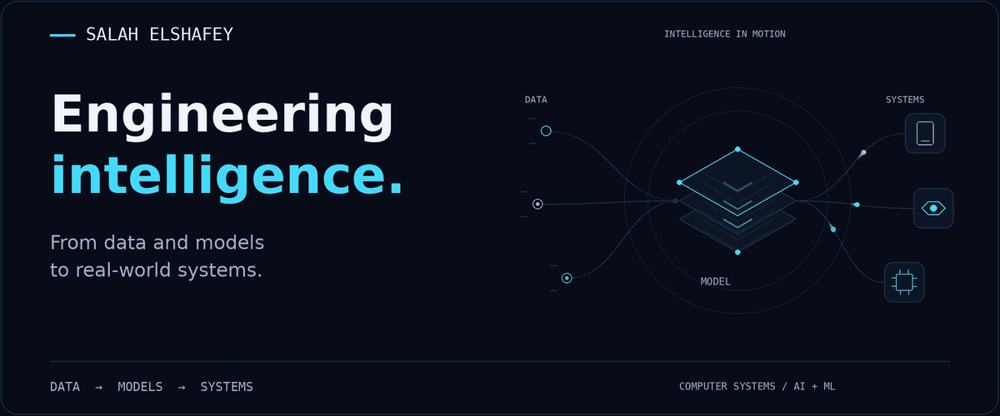
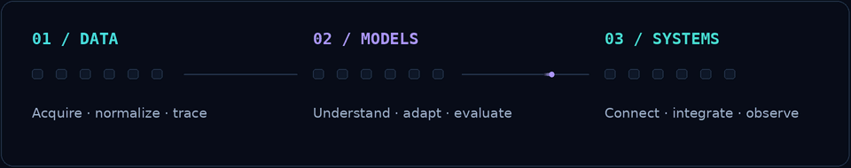
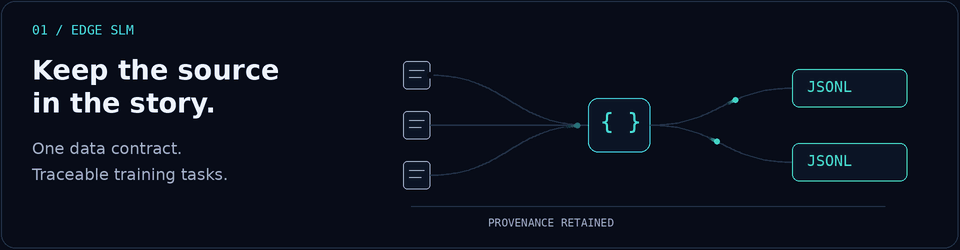
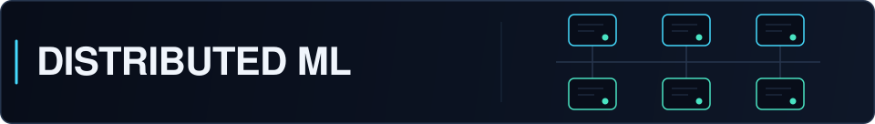
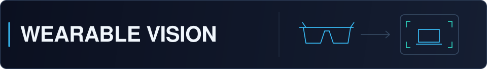
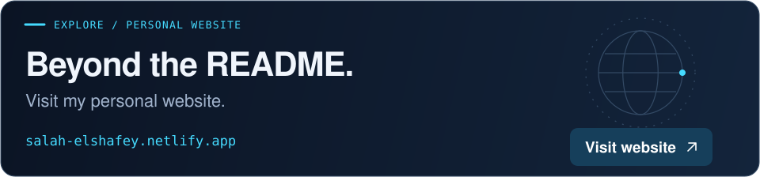

<picture>
  <source media="(max-width: 600px) and (prefers-reduced-motion: reduce) and (prefers-color-scheme: light)" srcset="assets/hero/hero-mobile-light-static.png">
  <source media="(max-width: 600px) and (prefers-reduced-motion: reduce)" srcset="assets/hero/hero-mobile-dark-static.png">
  <source media="(prefers-reduced-motion: reduce) and (prefers-color-scheme: light)" srcset="assets/hero/hero-light-static.png">
  <source media="(prefers-reduced-motion: reduce)" srcset="assets/hero/hero-dark-static.png">
  <source media="(max-width: 600px) and (prefers-color-scheme: light)" srcset="assets/hero/hero-mobile-light.gif">
  <source media="(max-width: 600px)" srcset="assets/hero/hero-mobile-dark.gif">
  <source media="(prefers-color-scheme: light)" srcset="assets/hero/hero-light.gif">
  
</picture>

# Salah Elshafey

**Computer Systems Engineer · AI & Machine Learning · Intelligent Systems**

I work on the path from raw data to useful intelligence: traceable datasets, language-model experiments, and computer vision connected to software and hardware.

<a href="https://salah-elshafey.netlify.app/"><picture><source media="(prefers-color-scheme: light)" srcset="assets/contact/website-light.svg"></picture></a>
<a href="mailto:Salaheldinelshafie@gmail.com"><picture><source media="(prefers-color-scheme: light)" srcset="assets/contact/email-light.svg"></picture></a>
<a href="https://www.linkedin.com/in/salah-elshafey/"><picture><source media="(prefers-color-scheme: light)" srcset="assets/contact/linkedin-light.svg"></picture></a>
<a href="https://drive.google.com/file/d/1Vv9GS6_QjldfRYYANVyX-hqmCcank_7z/view?usp=sharing"><picture><source media="(prefers-color-scheme: light)" srcset="assets/contact/resume-light.svg"></picture></a>
<a href="https://github.com/SalahElshafey"><picture><source media="(prefers-color-scheme: light)" srcset="assets/contact/github-light.svg"></picture></a>

[Approach](#data-models-systems) · [Selected work](#selected-engineering-work) · [Toolbox](#technical-toolbox) · [Connect](#lets-build-something-meaningful)

## Data. Models. Systems.

A model is one part of the work. I care about where its data came from, what its compute budget allows, and how its outputs reach an application or device.

<picture>
  <source media="(max-width: 600px) and (prefers-reduced-motion: reduce) and (prefers-color-scheme: light)" srcset="assets/motion/data-models-systems-mobile-light-static.png">
  <source media="(max-width: 600px) and (prefers-reduced-motion: reduce)" srcset="assets/motion/data-models-systems-mobile-dark-static.png">
  <source media="(prefers-reduced-motion: reduce) and (prefers-color-scheme: light)" srcset="assets/motion/data-models-systems-light-static.png">
  <source media="(prefers-reduced-motion: reduce)" srcset="assets/motion/data-models-systems-dark-static.png">
  <source media="(max-width: 600px) and (prefers-color-scheme: light)" srcset="assets/motion/data-models-systems-mobile-light.gif">
  <source media="(max-width: 600px)" srcset="assets/motion/data-models-systems-mobile-dark.gif">
  <source media="(prefers-color-scheme: light)" srcset="assets/motion/data-models-systems-light.gif">
  
</picture>

## Selected engineering work

Three studies in data and models, followed by three projects connecting software to the physical world. The illustrations are conceptual diagrams; each repository documents the implementation and its limits.

### 01 / Edge SLM

**Training data with a traceable path back to its source.**

<picture>
  <source media="(max-width: 600px) and (prefers-reduced-motion: reduce) and (prefers-color-scheme: light)" srcset="assets/projects/edge-slm-mobile-light-static.png">
  <source media="(max-width: 600px) and (prefers-reduced-motion: reduce)" srcset="assets/projects/edge-slm-mobile-dark-static.png">
  <source media="(prefers-reduced-motion: reduce) and (prefers-color-scheme: light)" srcset="assets/projects/edge-slm-light-static.png">
  <source media="(prefers-reduced-motion: reduce)" srcset="assets/projects/edge-slm-dark-static.png">
  <source media="(max-width: 600px) and (prefers-color-scheme: light)" srcset="assets/projects/edge-slm-mobile-light.gif">
  <source media="(max-width: 600px)" srcset="assets/projects/edge-slm-mobile-dark.gif">
  <source media="(prefers-color-scheme: light)" srcset="assets/projects/edge-slm-light.gif">
  
</picture>

Technical knowledge arrives as PDFs, slides, text, and media. This pipeline normalizes those sources, retains provenance through section-aware chunking, and exports structured study-note tasks. A local Streamlit interface runs ingestion and prepares the downstream handoff.

**Scope:** data preparation and ingestion are implemented; enrichment, fine-tuning, quantization, and model evaluation are downstream stages.

`Python` `Streamlit` `Multimodal ingestion` `Dataset engineering`

[Explore the data pipeline →](https://github.com/SalahElshafey/Edge-SLM-Offline-Domain-Specific-Small-Language-Model-Pipeline)

### 02 / Distributed LLM Fine-Tuning

**What changes when a model must fit across memory-constrained machines?**

<picture>
  <source media="(prefers-color-scheme: light)" srcset="assets/project-hpc-light.svg">
  
</picture>

DistilGPT2 and OPT-2.7B experiments explore LoRA, distributed data parallelism, and DeepSpeed pipeline parallelism on a multi-node CPU cluster. Training scripts and SLURM launchers make the compute strategy explicit; the original private cluster is not publicly accessible.

`PyTorch` `Transformers` `LoRA` `DDP` `DeepSpeed` `SLURM`

[Inspect the training strategies →](https://github.com/SalahElshafey/VT-Cluster--Parallel-and-Distributed-Programming-of-Machine-Learning-Models)

### 03 / GPT Visualization

**Understand the transformer by building its parts.**

<picture>
  <source media="(prefers-color-scheme: light)" srcset="assets/project-gpt-light.svg">
  
</picture>

Educational PyTorch notebooks connect tokenization and embeddings to causal self-attention, decoder blocks, and language-model training loops. The emphasis is on making the mechanisms inspectable through code and exercises.

`Python` `PyTorch` `Jupyter` `Transformer fundamentals`

[Step inside the notebooks →](https://github.com/SalahElshafey/GPT-Visualization)

---

### 04 / Aria Glasses Object Recognition

<picture>
  <source media="(prefers-color-scheme: light)" srcset="assets/project-aria-light.svg">
  
</picture>

**Computer vision from a first-person perspective.** YOLOv8n experiments use Project Aria recordings and a custom annotated dataset. Training, video inference, and streaming code sit alongside documented USB and Wi-Fi limitations.

`YOLOv8n` `OpenCV` `Project Aria` `Roboflow`

[Explore wearable vision →](https://github.com/SalahElshafey/RGU-Aria-Meta-Glasses-Object-Recognition-in-Daily-Life)

### 05 / Virtual Reality Fitness Trainer

<picture>
  <source media="(prefers-color-scheme: light)" srcset="assets/project-vr-light.svg">
  
</picture>

**Turn exercise recognition into a signal other systems can use.** This team project brings together vision, Unity, and wearable sensing. The default MachineLearning branch contains training and inference work, model outputs, and MQTT messages carrying predicted exercise classes.

`Python` `YOLOv8` `OpenCV` `MQTT` · Unity and sensing in the wider team system

[Explore the fitness project →](https://github.com/SalahElshafey/Virtual-Reality-Fitness-Trainer)

### 06 / Home Security App

<picture>
  <source media="(prefers-color-scheme: light)" srcset="assets/project-home-light.svg">
  
</picture>

**Make device state visible and actionable.** A Java/AndroidX application connects Firebase authentication, locker-state controls, buzzer alerts, and timestamped history through Firebase Realtime Database.

`Java` `Android` `AndroidX` `Firebase` `Gradle`

[View the Android application →](https://github.com/SalahElshafey/HomeSecurityApp)

## Further explorations

[Image processing](https://github.com/SalahElshafey/Image-Processing) — OpenCV experiments &nbsp; / &nbsp; [Desktop software](https://github.com/SalahElshafey/Computer-System-Company) — C# application

[Air hockey](https://github.com/SalahElshafey/Air-Hockey_OpenGL) — OpenGL &nbsp; / &nbsp; [URL Saver](https://github.com/SalahElshafey/URL-Saver-Extension) — JavaScript browser extension

## Technical toolbox

Tools and methods used across these projects. The repositories show the context and depth of each.

  **Machine learning** 
Python · PyTorch · Hugging Face Transformers · NumPy · Jupyter · Streamlit

 **Computer vision** 
OpenCV · YOLOv8 · Roboflow · Object detection · Pose estimation

**Distributed and systems** 
Linux · SLURM · DeepSpeed · DDP · LoRA · MQTT

   **Application engineering** 
Java · Android · Firebase · JavaScript · C# · Windows Forms

  **Embedded and immersive** 
C · C++ · Arduino · ESP8266 · Unity

## Currently exploring

Transformer internals, memory-efficient model training, and application development with Java and JavaScript. I use these studies to connect model behavior with the engineering choices around it.

## On GitHub

Follow the work through [my repositories](https://github.com/SalahElshafey?tab=repositories) and [contribution activity](https://github.com/SalahElshafey?tab=overview).

## Let’s build something meaningful

Working on language models, computer vision, or an intelligent system that needs to meet the physical world? I’d enjoy comparing approaches and discussing a collaboration.

<a href="https://salah-elshafey.netlify.app/">
  <picture>
    <source media="(max-width: 600px) and (prefers-color-scheme: light)" srcset="assets/contact/website-card-mobile-light.svg">
    <source media="(max-width: 600px)" srcset="assets/contact/website-card-mobile-dark.svg">
    <source media="(prefers-color-scheme: light)" srcset="assets/contact/website-card-light.svg">
    
  </picture>
</a>

<a href="https://salah-elshafey.netlify.app/"><picture><source media="(prefers-color-scheme: light)" srcset="assets/contact/website-light.svg"></picture></a>
<a href="mailto:Salaheldinelshafie@gmail.com"><picture><source media="(prefers-color-scheme: light)" srcset="assets/contact/email-light.svg"></picture></a>
<a href="https://www.linkedin.com/in/salah-elshafey/"><picture><source media="(prefers-color-scheme: light)" srcset="assets/contact/linkedin-light.svg"></picture></a>
<a href="https://drive.google.com/file/d/1Vv9GS6_QjldfRYYANVyX-hqmCcank_7z/view?usp=sharing"><picture><source media="(prefers-color-scheme: light)" srcset="assets/contact/resume-light.svg"></picture></a>
<a href="https://github.com/SalahElshafey"><picture><source media="(prefers-color-scheme: light)" srcset="assets/contact/github-light.svg"></picture></a>

[salah-elshafey.netlify.app](https://salah-elshafey.netlify.app/) · [Salaheldinelshafie@gmail.com](mailto:Salaheldinelshafie@gmail.com)

Also on [X / Twitter](https://twitter.com/salah_elshafie) and [Facebook](https://fb.com/salah.cx).

---

<strong>SALAH ELSHAFEY</strong> &nbsp; / &nbsp; DATA → MODELS → SYSTEMS
