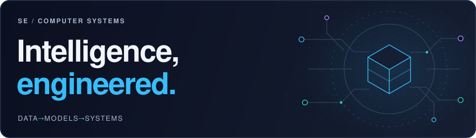

<picture>
  <source media="(max-width: 600px) and (prefers-color-scheme: light)" srcset="assets/profile-hero-mobile-light.svg">
  <source media="(max-width: 600px)" srcset="assets/profile-hero-mobile.svg">
  <source media="(prefers-color-scheme: light)" srcset="assets/profile-hero-light.svg">
  
</picture>

# Salah Elshafey

**Computer Systems Engineer · AI & Machine Learning · Intelligent Systems**

I build the connections between data, models, and the systems that put them to work.

[GitHub](https://github.com/SalahElshafey) · [LinkedIn](https://www.linkedin.com/in/salah-elshafey/) · [Resume](https://drive.google.com/file/d/1Vv9GS6_QjldfRYYANVyX-hqmCcank_7z/view?usp=sharing) · [Email](mailto:Salaheldinelshafie@gmail.com)

[About](#about) &nbsp; / &nbsp; [Featured work](#featured-work) &nbsp; / &nbsp; [Toolbox](#technical-toolbox) &nbsp; / &nbsp; [Connect](#lets-connect)

## About

My work spans language-model data pipelines, distributed fine-tuning experiments, and computer vision for wearable and interactive systems. I’m interested in the whole path: preparing traceable data, understanding model behavior, and connecting predictions to software and hardware.

**Currently exploring:** transformer internals, memory-efficient training, and application development with Java and JavaScript.

## Featured work

Selected individual and collaborative projects. Each repository contains the implementation, context, and scope of the work.

### 01 — Edge SLM

<a href="https://github.com/SalahElshafey/Edge-SLM-Offline-Domain-Specific-Small-Language-Model-Pipeline">
  <picture>
    <source media="(prefers-color-scheme: light)" srcset="assets/project-edge-slm-light.svg">
    
  </picture>
</a>

**Training data with a traceable path back to its source.** A multimodal ingestion pipeline that normalizes documents and media, preserves provenance through chunking, and exports structured study-note tasks. A Streamlit interface supports local ingestion; model enrichment, fine-tuning, and deployment are downstream stages.

`Python` `Streamlit` `Document processing` `Dataset engineering`

[Explore the pipeline →](https://github.com/SalahElshafey/Edge-SLM-Offline-Domain-Specific-Small-Language-Model-Pipeline)

### 02 — Distributed LLM Fine-Tuning

<a href="https://github.com/SalahElshafey/VT-Cluster--Parallel-and-Distributed-Programming-of-Machine-Learning-Models">
  <picture>
    <source media="(prefers-color-scheme: light)" srcset="assets/project-hpc-light.svg">
    
  </picture>
</a>

**Exploring model training within tight memory budgets.** DistilGPT2 and OPT-2.7B experiments on a multi-node CPU cluster, using LoRA, distributed data parallelism, and DeepSpeed pipeline parallelism. Includes training scripts and SLURM launchers; the original cluster is private.

`PyTorch` `Transformers` `LoRA` `DeepSpeed` `SLURM`

[Inspect the training strategies →](https://github.com/SalahElshafey/VT-Cluster--Parallel-and-Distributed-Programming-of-Machine-Learning-Models)

### 03 — GPT Visualization

<a href="https://github.com/SalahElshafey/GPT-Visualization">
  <picture>
    <source media="(prefers-color-scheme: light)" srcset="assets/project-gpt-light.svg">
    
  </picture>
</a>

**Opening up the transformer, one component at a time.** Educational notebooks explore GPT-style language modeling through tokenization, embeddings, causal self-attention, decoder blocks, and training loops. A hands-on study of the mechanisms behind text generation.

`Python` `PyTorch` `Jupyter` `Transformers`

[Step inside the notebooks →](https://github.com/SalahElshafey/GPT-Visualization)

### 04 — Aria Glasses Object Recognition

<a href="https://github.com/SalahElshafey/RGU-Aria-Meta-Glasses-Object-Recognition-in-Daily-Life">
  <picture>
    <source media="(prefers-color-scheme: light)" srcset="assets/project-aria-light.svg">
    
  </picture>
</a>

**Object detection from a first-person perspective.** YOLOv8n experiments with Project Aria recordings, a custom annotated dataset, and streaming integration. The repository documents the recognition workflow alongside USB and Wi-Fi streaming limitations.

`Python` `YOLOv8` `OpenCV` `Project Aria` `Roboflow`

[Explore wearable vision →](https://github.com/SalahElshafey/RGU-Aria-Meta-Glasses-Object-Recognition-in-Daily-Life)

### 05 — Virtual Reality Fitness Trainer

<a href="https://github.com/SalahElshafey/Virtual-Reality-Fitness-Trainer">
  <picture>
    <source media="(prefers-color-scheme: light)" srcset="assets/project-vr-light.svg">
    
  </picture>
</a>

**Connecting exercise recognition to interactive coaching.** A team project combining computer vision, a Unity environment, and wearable sensing. The default branch contains the machine-learning work: training and inference scripts, model outputs, and MQTT messaging for predicted exercise classes.

`Python` `YOLOv8` `OpenCV` `MQTT` `Unity`

[Explore the fitness project →](https://github.com/SalahElshafey/Virtual-Reality-Fitness-Trainer)

### 06 — Home Security App

<a href="https://github.com/SalahElshafey/HomeSecurityApp">
  <picture>
    <source media="(prefers-color-scheme: light)" srcset="assets/project-home-light.svg">
    
  </picture>
</a>

**A mobile interface for connected-home controls.** An Android application with Firebase authentication, locker-state controls, buzzer alerts, and timestamped history. Built with Java and AndroidX, with Firebase Realtime Database connecting interface actions and device state.

`Java` `Android` `AndroidX` `Firebase` `Gradle`

[View the Android application →](https://github.com/SalahElshafey/HomeSecurityApp)

**More to explore:** [OpenCV image-processing experiments](https://github.com/SalahElshafey/Image-Processing) · [C# desktop application](https://github.com/SalahElshafey/Computer-System-Company) · [OpenGL air hockey](https://github.com/SalahElshafey/Air-Hockey_OpenGL) · [JavaScript browser extension](https://github.com/SalahElshafey/URL-Saver-Extension)

## Technical toolbox

Technologies used across my projects and experiments; the linked repositories show how I use them.

| Area | Technologies & methods |
| :--- | :--- |
|   **AI & data** | Python, PyTorch, Transformers, NumPy, Streamlit, Jupyter |
|  **Computer vision** | OpenCV, YOLOv8, Roboflow, object detection, pose estimation |
| **Distributed systems** | Linux, SLURM, DeepSpeed, DDP, LoRA, MQTT |
|    **Applications** | Java, Android SDK, AndroidX, C#, Windows Forms, Firebase, JavaScript |
|   **Hardware & immersive** | C++, Arduino, ESP8266, Unity, wearable sensing |

My programming background also includes **C**.

## GitHub activity

[Browse my repositories](https://github.com/SalahElshafey?tab=repositories) · [View contributions and activity](https://github.com/SalahElshafey?tab=overview)

## Let’s connect

Interested in language models, computer vision, or connecting software with hardware? I’d enjoy comparing approaches and discussing a project.

**[Salaheldinelshafie@gmail.com](mailto:Salaheldinelshafie@gmail.com)** · [LinkedIn](https://www.linkedin.com/in/salah-elshafey/) · [Resume](https://drive.google.com/file/d/1Vv9GS6_QjldfRYYANVyX-hqmCcank_7z/view?usp=sharing)

Also on [X / Twitter](https://twitter.com/salah_elshafie) and [Facebook](https://fb.com/salah.cx).

---

Salah Elshafey &nbsp; / &nbsp; Data → Models → Systems
